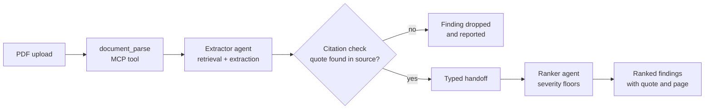

 

I'm a Software Engineering student at Florida Gulf Coast University (B.S. Software Engineering, minor in Mathematics, expected Spring 2027). I build AI applications that have to hold up in front of real users: retrieval systems that cite their sources, multi-agent pipelines with validation between steps, and computer vision that reports its own limits.

- **Applied AI.** RAG and agent systems built during internships at Infosys and Engage Estero, plus a multi-agent contract scanner with a fail-closed citation check.
- **Software engineering.** Typed contracts between services, unit, integration and end-to-end tests, CI, and deployments on Azure and Vercel.
- **Team delivery.** Every featured project below was built with a team or for an outside partner: a consulting firm, a community nonprofit, a food bank, a rocket club.

## Experience

| Role | Organization | What I worked on |
| --- | --- | --- |
| **AI Summer Intern** | [Engage Estero](https://esterotoday.com) | Civic information platform over public meeting records: document search with cited answers, GIS mapping of local decisions, and agentic workflows. Engage Estero is an independent community nonprofit, not the Village of Estero government. |
| **Software Engineering Intern** | Infosys (Summer 2025) | Built ORION, a generative AI assistant for mutual fund research using RAG, LangChain, Azure OpenAI, FAISS and Streamlit. |
| **Senior Project, Payload Team** | FGCU Rocket Club | Computer vision that classifies terrain in rocket camera frames and scores candidate landing areas. Prototype stage. |
| **Team Member** | AI Agent Studio (FGCU) | FinePrint Agent, a multi-agent system that finds costly clauses in contracts. I own the agent package. |
| **Developer** | Harry Chapin Food Bank collaboration | Volunteer management platform: scheduling, registration, kiosk check-in and hour tracking. |
| **Research** | Autonomous agricultural tractor (FGCU) | Explored LiDAR, ROS, sensor fusion and localization for navigation during GNSS outages. |

## Featured projects

<table>
<tr>
<td width="50%" valign="top">

### [FinePrint Agent](https://github.com/krocks9903/FIne_Print_Agent)
MULTI-AGENT AI · DOCUMENT INTELLIGENCE · TEAM OF 3

Upload a lease or contract and get a ranked list of clauses that can cost you money, each with the exact quote and page. An Extractor agent hands typed findings to a Ranker agent, and a citation validator drops any finding whose quote is not in the source text.

**Status:** course project in progress (Milestone 3 of 4).

`TypeScript` `Next.js` `MCP` `pdf.js` `Node test runner`

</td>
<td width="50%" valign="top">

### [Rocket Payload: Landing-Zone Analysis](https://github.com/krocks9903/Rocket_Payload)
COMPUTER VISION · TERRAIN ANALYSIS · SENIOR PROJECT

Segments downward-facing rocket footage into terrain classes, detects hazards such as roads, trees and structures, and ranks the three lowest-risk landing spots per frame.

**Status:** offline prototype evaluated on 13 frames of public flight footage. It does not guide or control a vehicle.

`Python` `scikit-image` `Ultralytics YOLOE` `OpenCV` `NumPy`

</td>
</tr>
<tr>
<td width="50%" valign="top">

### [ORION: GenAI Fund Advisor](https://github.com/krocks9903/-GenAi-fund-advisor-Summer-Internship-2025)
INFOSYS INTERNSHIP · RAG · FINANCIAL ANALYSIS

A chat assistant that answers questions about 16 mutual funds from prospectuses, investment reports and risk metrics. Documents are chunked with ticker-aware cleaning, embedded into FAISS, and retrieved through a LangChain conversational chain on Azure OpenAI, with sources shown per answer.

**Status:** internship project, Summer 2025.

`Python` `LangChain` `Azure OpenAI` `FAISS` `Streamlit` `Selenium`

</td>
<td width="50%" valign="top">

### [Estero Civic AI Platform](https://github.com/krocks9903/where-estero-decides)
ENGAGE ESTERO · GIS · CIVIC TECH · TEAM PROJECT

Two connected pieces. [Where Estero Decides](https://github.com/krocks9903/where-estero-decides) maps 2,618 public agenda items with the ArcGIS Maps SDK. [Ask Engage Estero](https://github.com/noleysc/rag-arcgis-chatbot) (team repo) answers questions about planning and zoning records using hybrid retrieval.

**Status:** active. Project layer on the map currently uses sample data.

`JavaScript` `ArcGIS Maps SDK` `FastAPI` `LangChain` `FAISS + BM25` `React`

</td>
</tr>
<tr>
<td width="50%" valign="top">

### [Volunteer Management Platform](https://github.com/krocks9903/ServiceLearningProject)
HARRY CHAPIN FOOD BANK · FULL-STACK · TEAM PROJECT

Volunteers sign up, register for events and shifts, and check in at a kiosk. Staff manage shifts, approve hours and export reports. Covered by unit, integration and Playwright end-to-end tests.

**Status:** course project, last updated December 2025. [Deployed build](https://service-learning-project-lyart.vercel.app)

`React 19` `TypeScript` `Supabase` `Vite` `Vitest` `Playwright`

</td>
<td width="50%" valign="top">

### More work
OCR · AUTOMATION · RESEARCH · TESTING

- [ID document OCR](https://github.com/krocks9903/OCR-with-Tesseract-and-Python): Tesseract with image preprocessing and regex field extraction
- [Lightning strike analysis](https://github.com/krocks9903/Lightning-Research-Using-Python): heatmaps and peak-current mapping with pandas and Folium
- n8n automations: [stock analysis agent](https://github.com/krocks9903/WhatsappStockAnalysisn8n), [WhatsApp chatbot](https://github.com/krocks9903/WhatsappN8Ngpt4bot), [news translator](https://github.com/krocks9903/n8n-ai-news-translator)
- [Selenium test suite](https://github.com/krocks9903/CEN4072-Final-Project): Java, TestNG, Maven

</td>
</tr>
</table>

<b>How FinePrint Agent processes a document</b>

 

<b>Rocket Payload output across 13 frames, pad to 3,900 ft</b>

 

## Technical stack

Everything listed here is used in a repository linked above.

| Area | Tools |
| --- | --- |
| **Languages** | Python, TypeScript, JavaScript, Java, C, C++, SQL |
| **AI and retrieval** | LangChain, RAG, FAISS, BM25 hybrid search, Azure OpenAI, Claude API, Model Context Protocol (MCP), multi-agent orchestration |
| **Computer vision** | scikit-image, Ultralytics YOLOE, OpenCV, Tesseract OCR |
| **Web and APIs** | React, Next.js, FastAPI, Streamlit, Vite |
| **Data and geospatial** | PostgreSQL, Supabase, pandas, NumPy, ArcGIS Maps SDK for JavaScript |
| **Testing** | Vitest, Playwright, Selenium, TestNG, Node test runner |
| **Cloud and tooling** | Azure App Service, Vercel, Docker, GitHub Actions, n8n, Git |

<!--
## Certifications

Add this section back once the credential link is in place:

- Oracle Cloud Infrastructure Generative AI Professional ([credential](ADD-CREDENTIAL-URL))
-->

## Activity

- [All repositories](https://github.com/krocks9903?tab=repositories&sort=updated), sorted by most recent work
- [Pull requests I've opened](https://github.com/search?q=author%3Akrocks9903+is%3Apr&type=pullrequests)
- Contribution calendar: on [my profile](https://github.com/krocks9903), below the pinned repositories

## Contact

Open to software engineering, AI engineering and machine learning roles.

[LinkedIn](https://linkedin.com/in/krish-sshah) · [Email](mailto:ksshah1283@eagle.fgcu.edu) · [GitHub](https://github.com/krocks9903)
